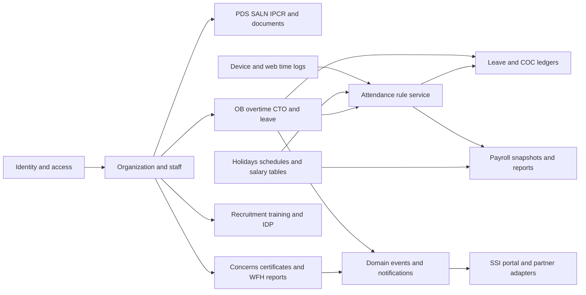

# Architecture for the Laravel rebuild

## Existing structure

The repository declares Laravel `^7.29`, PHP `^7.2.5|^8.0`, Laravel UI 2, Carbon 2, Mix 5, Vue 2, Bootstrap 4 and jQuery. These are declared constraints; inspect `composer.lock` and `package-lock.json` for resolved versions. Controllers route through the default `App\Http\Controllers` namespace in `RouteServiceProvider`, and most business models live directly in `app/`.

Business logic crosses several layers. `DTR.php`, `DtrHelpers.php`, `DTRController`, `HolidayController`, `HRStaffController`, and cron/command implementations contain attendance rules. Payroll templates calculate amounts in JavaScript. `Status.php` and `statuses` represent shared approval history, usually using the greatest status ID for the current state. Some modules instead keep status and signature timestamps on their own records. PDF and Excel views carry report formatting and some calculations.

Sources: [composer.json](../../composer.json), [package.json](../../package.json), [RouteServiceProvider](../../app/Providers/RouteServiceProvider.php), [HTTP kernel](../../app/Http/Kernel.php), [AuthServiceProvider](../../app/Providers/AuthServiceProvider.php), [models and relationships](inventories/MODELS.md).

## Proposed technology baseline

| Area | Proposed rebuild choice | Required verification |
| --- | --- | --- |
| Framework/runtime | Laravel 13, PHP 8.4, Composer 2 | Official Laravel 13 minimum is PHP 8.3; verify hosting extensions and package compatibility |
| Application style | Modular monolith using one deployment and database | Preserve module boundaries through actions/services and policies |
| Browser UI | Blade, Vite, accessible responsive components; progressive JavaScript for calendars, tables and forms | Confirm UI expectations before choosing an additional reactive framework |
| Database | MySQL-compatible database initially | Capture actual engine/version, collation, SQL modes, timezone and JSON semantics; test new migrations on selected production engine |
| Authorization | Named abilities with policies and organization/ownership scope | Explicitly map numeric legacy roles and special approvers |
| Background work | Laravel jobs and scheduler, managed queue worker and shared locks when needed | Retry safely; no duplicate financial/credit effects |
| Files | Private disks for personnel documents and signatures; explicitly public portal branding assets | Authorized downloads and signed time-limited links where appropriate |
| Reports | Compatible PDF, spreadsheet and QR libraries selected through a proof of concept | Validate layout, encoding, fonts, totals, signature images and page breaks |
| Validation | Form Requests, domain validators and explicit response resources | Preserve compatibility response shape only where a caller needs it |

This is a design proposal, not an assertion that existing dependencies support Laravel 13. Select maintained compatible releases or replacements; commit lockfiles after dependency resolution. Laravel 13 release/runtime requirements are verified against [official release notes](https://laravel.com/docs/13.x/releases) and [deployment documentation](https://laravel.com/docs/13.x/deployment).

## Module boundaries and data flow



Suggested organization inside the new app:

```text
app/Models/                     Persistence models, casts and relationships
app/Policies/                   Access and ownership rules
app/Http/Controllers/           HTTP orchestration only
app/Http/Requests/              Validated input and authorization
app/Actions/<Domain>/           Transactional use cases and transitions
app/Services/Attendance/        One effective-dated attendance calculator
app/Services/Payroll/           Money calculations and snapshots
app/Services/Approvals/         Routing and transition guards
app/Integrations/               SSI, DTS and device-sync adapters
app/Jobs/                       Retriable background work
app/Console/Commands/           Explicit, auditable maintenance commands
resources/views/<domain>/      Screens and separate report templates
tests/Feature/<domain>/        Requests, permissions and workflows
tests/Unit/<domain>/           Pure calculations and state rules
```

These folders are proposed conventions; avoid a custom framework or microservices for this rebuild. Split complex actions only when their responsibilities justify it.

## Shared domain contracts

**Identity:** separate authentication identity, employee identity, ATMS/device ID and external-system identity. Preserve legacy IDs during import or keep a durable mapping. Email is mutable; it cannot safely substitute for a permanent cross-system identifier without partner agreement.

**Approvals:** each command verifies actor, current state, ownership/division, effective delegation, and allowed transition. Record actor, subject, previous/new states, reason, timestamp and origin. Latest status is keyed by request type and ID together. Preserve history; do not delete old transitions to simulate a rollback.

**Credits:** use append-only entries for grants, deductions, expirations and reversals. Associate each entry with its source request/period and an idempotency key. Compute balances from valid entries or a reconciled projection. A retry, approval double-click or nightly rerun must produce one effect. Determine permitted negative balances and expiration policy from approved business rules.

**Attendance:** raw device/web events are evidence; daily DTR rows are derived results. Supply employee/schedule effective on that date, events, holidays/suspensions, approved requests and approved overrides to one deterministic calculation service. Store rule version, inputs/provenance and the resulting minutes. Manual corrections retain reason and actor. Reprocessing a range must not reapply credit movements.

**Money:** compute on the server with decimal values or integer minor units, explicit rounding and approved rates. Snapshot payroll inputs and finalized line results. Reports read the snapshot; later salary changes must not rewrite old payslips or certificates.

**Files and signatures:** store opaque generated keys, original filename, MIME, size, checksum, owner and purpose. Access follows the parent record's policy. A stored signature image is an image, not cryptographic proof of a signer's approval; associate every displayed signature with an authenticated action and audit timestamp.

**Notifications:** domain events trigger delivery after the transaction commits. Separate a notification's content/audience from recipient-specific read/dismiss state. Email failure must not roll back an approved HR request. External delivery uses timeouts, bounded retries and deduplication.

## Security and UX requirements

- [ ] Default protected application areas to authenticated access and deny actions lacking a policy.
- [ ] Restrict queries before loading records; check nested child ownership as well as parent IDs.
- [ ] Protect browser writes with CSRF, use write HTTP methods, throttle login and public verification APIs, and validate redirect destinations.
- [ ] Replace numeric employee/user allowlists with configured, effective-dated roles/delegations.
- [ ] Exclude hashes, tokens, government identifiers, private URLs and signature paths from generic user JSON.
- [ ] Authorize reports, exports, search/autocomplete, bulk actions and file downloads independently of menu access.
- [ ] Use date and timezone conventions consistently; preserve legacy Manila wall-clock meaning during migration.
- [ ] Present clear pending/returned/approved states, validation messages, empty states, accessible forms and keyboard navigation.
- [ ] Use one layout/component system, consistent tables and filters, and approved print layouts.
- [ ] Make long imports/exports jobs with progress/failure results; design pagination for growing gate logs and staff reports.

## Compatibility migration

Keep a disposition for each legacy route. Introduce a thin adapter when a partner or old bookmarked URL must remain valid; adapters validate and authorize before invoking the new action. Browser templates can change while stable URLs remain. Public job-trigger GET routes and mass password reset utilities should be retired through an operational transition, with scheduler commands replacing them. The endpoint inventory identifies duplicate declarations and handler names without explicit implementations; do not automatically generate features from those names.
